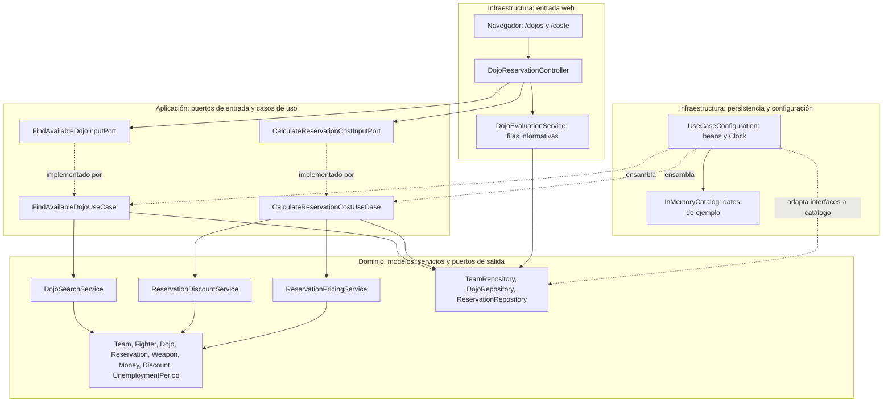
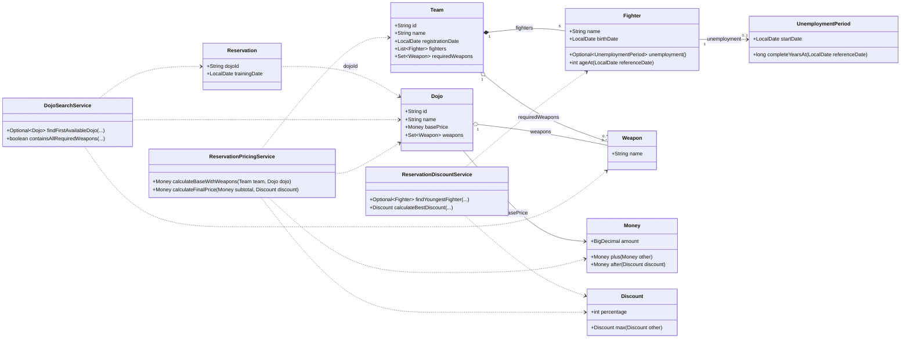

# P3 · Arquitectura y modelo del dominio

Los diagramas representan **las clases y dependencias que existen en el proyecto Java de partida**. Ayudan a localizar responsabilidades, pero **no resuelven los grafos de flujo, los caminos independientes ni los casos de prueba**. Los resultados esperados se deducen de [la especificación funcional](ESPECIFICACION.md), no de la implementación inicial, que puede contener defectos.

## 1. Arquitectura de la aplicación

El proyecto separa presentación e infraestructura, aplicación y dominio. Las interfaces de repositorio (`TeamRepository`, `DojoRepository`, `ReservationRepository`) pertenecen al dominio. Su implementación concreta en memoria y el ensamblaje de dependencias corresponden a infraestructura.

**Lectura de las flechas:** las continuas expresan uso/dependencia de ejecución; las discontinuas, implementación o ensamblaje. `DojoEvaluationService` es una proyección de presentación para la tabla web, no el servicio de dominio encargado de seleccionar el dojo. El dominio no depende de Spring Boot ni de Selenium.

## 2. Diagrama UML de clases del contexto acotado

Se representan los atributos y operaciones relevantes para comprender el problema, sin pretender enumerar todos los constructores, validaciones o métodos auxiliares.

**Aclaraciones sobre el modelo:**

- `Team` contiene **exactamente cinco** referencias a luchadores; los valores pueden repetirse, como ocurre en los datos de ejemplo. El diagrama expresa la cardinalidad del equipo, no la unicidad de los objetos.
- `Team.requiredWeapons` describe armas requeridas; `Dojo.weapons` describe armas disponibles. Los conjuntos contienen objetos `Weapon`.
- `Reservation` guarda el **identificador** del dojo y la fecha del entrenamiento; la dependencia del dibujo no representa un campo de tipo `Dojo`.
- `Fighter` puede tener un período de desempleo o no tenerlo.
- Las operaciones de `DojoSearchService` y `ReservationDiscountService` son objeto de las pruebas de caja blanca; las pruebas Selenium recorren la aplicación desde la interfaz web.

## 3. Cómo utilizar los diagramas en la práctica

Para la **caja blanca**, localizar los métodos asignados en los servicios de dominio y construir sus propios grafos a partir del código real. Este UML no es un grafo de control.

Para la **caja negra**, deducir clases de equivalencia, límites y resultados esperados de la especificación y contrastarlos mediante las pantallas web. La arquitectura permite entender qué capas intervienen, pero no revela por sí sola todas las reglas de negocio.

Los servicios y repositorios se pueden probar sin navegador; Selenium es una prueba de extremo a extremo desde la interfaz web.
